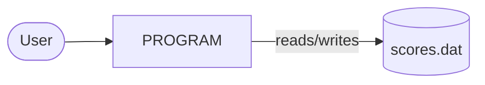
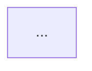

# /re-doc - how the analyzed program is built (docs/ARCHITECTURE.md)

Arguments: `$ARGUMENTS`
- binary id from decompile.yaml (optional; default: `current`). The document
  describes the program as a whole; with several binaries, components may span
  them and evidence names the binary (`core: FUN_00402210 @ 0x00402210`).
- `--refresh`: update the existing docs/ARCHITECTURE.md from new evidence, keep the rest
- `--review`: independent review of every [C] claim by a fresh agent (Step 7)
- `--lang sl|en`: language of the prose (default: `settings.lang_docs` in
  decompile.yaml, else the language the user writes in). Section numbers stay the same.

The reader wants to understand **how the program is built and how it runs**, not a
list of functions. Write at the level of components and behaviour. Functions and
addresses appear only as evidence and as entry points for drilling down.

## Rules

- Every claim carries a status: **[C]** confirmed (review/ cards, the user's notes, or
  xrefs/values you cite) or **[H]** hypothesis. When in doubt, [H]. Names, also real
  ones from debug info, identify a function; what it does comes from the code.
- Evidence is concrete: `` `FUN_00402210` @ 0x00402210 references "scores.dat" ``,
  `import USER32!GetMessageA`, `review/app/save_scores.md`, `TD32 Unit1::TMainForm`.
- The user's notes (`## My notes` in the `review/` cards, NOTES.md) win over your own reading. Never contradict them
  silently; if you disagree, say so under section 8.
- Diagrams support the text; every diagram is followed by 1 to 3 sentences that say
  what it shows. Max ~12 boxes per diagram; put detail in the text.
- No invented names, numbers or components. Unknown = say unknown.

## Step 1 - Facts (cheap, broad)

The binary: the id given, otherwise `current` (`re status` lists all, `re path <id>`
gives the file).

1. `file`, `rabin2 -I`, `rabin2 -i` (imports), `rabin2 -S` (sections),
   `rabin2 -U` for PE resources, or `readelf -d -S` for ELF.
2. The export: if `re status` says it is missing, run `exportjson.sh <id>`.
   Query it with `outq -b <id>`, never by loading it whole: `info`, `roots`
   (hand-off candidates: handlers and callbacks have no direct callers),
   `imports`, `strings <regex>`, `show <name> [from:to]`, `grep <regex> [name]`.
   Call chains, counts and calls between binaries: `outq sql "..."`.
   If `outq info` reports real names, they are already in the export; do not
   extract symbols from the binary again.
3. Read the cards in `review/<id>/` and, if present, `docs/map/modules.json` from `/re-map`.

## Step 2 - Archetype first

Decide what kind of program this is, with evidence. Typical archetypes:

| Archetype | Tell-tale evidence | Hand-off points to look for |
| --- | --- | --- |
| Win32 message loop | `RegisterClass*`, `CreateWindowEx*`, `GetMessage*`/`DispatchMessage*` | window procedure(s): `switch` on `WM_*` |
| Dialog-based Win32 | `DialogBoxParam*`, `CreateDialog*` | dialog procedure, `WM_COMMAND` by control ID |
| Delphi / C++Builder VCL | `TApplication`, `TForm`, RCDATA forms, Borland RTL | `Application.Run`, event handlers named in DFM |
| MFC | `MFC42.DLL`, RTTI `.?AV...`, message maps | handlers in message map tables |
| VB5/6 | `MSVBVM60.DLL`, `ThunRTMain`, `VB5!` | form/control event procedures |
| DOS game / real-time | `INT 10h/21h/33h`, port I/O, timer hooks | main loop: input, update, draw, wait |
| Console / batch tool | `main`, argv parsing, stdio only | command dispatch |
| Linux GUI (GTK/Qt/X11) | `gtk_main`, `QApplication`, `XNextEvent` | signal/slot or event callbacks |
| Shared library (.so / .dll) | no `main`; dynamic symbol table with exports, `DT_SONAME` | each exported function; callbacks it accepts; constructors (`.init_array`) |
| Plugin / backend | one exported entry (`*_init`, `sane_*`, `gst_plugin_desc`), table of function pointers | the registered function table |

Then find the **hand-off points**: where control enters the program's own code
from the outside. For a program: where the framework or main loop calls it. For
a library: every exported function, the callbacks it accepts, its constructors.
`outq roots` lists the candidates. These are the doors to the components, and
the description goes top-down from them: what each door offers first, how it is
done second.

For a library, the "context" (section 2) is its callers and what it reaches below
(device, files, other libraries), and "runtime" (section 5) is the life cycle a caller
goes through: init, typical call sequence, threads and callbacks, teardown.
Point to documents written by other skills when they exist instead of repeating them.

## Step 3 - Components (3 to 10)

Follow each hand-off point one or two levels down and group by responsibility
(UI, game logic, rendering, sound, input, persistence, configuration, network,
licensing, ...). For each component:
- one-sentence responsibility,
- how it works in 2 to 5 sentences (mechanism, not function lists),
- entry points (function @ address), what it talks to, evidence, status.
If `docs/map/modules.json` exists, reuse its module ids (`re-map module: <id>`) so the
text and the map tell the same story. Read the few functions you need closely with
`outq -b <id> show <name>`.

## Step 4 - Runtime

Describe in order: start-up, the main loop or event handling, shutdown, and 1 to 3
key scenarios the user cares about (ask if none is obvious, e.g. "what happens when
the user saves"). Each as a numbered list of steps with evidence, plus a Mermaid
`sequenceDiagram` for start-up and for the most important scenario.

## Step 5 - Data

Central structures (name, size, known fields with offsets, who uses them) and file
or wire formats (layout as a table: offset, size, meaning, evidence).

## Step 6 - Write docs/ARCHITECTURE.md in exactly this structure

~~~markdown
# Architecture: <PROGRAM>

Status: draft | Based on: out.<id>.json, <n> review cards, docs/map/modules.json (yes/no) | Legend: [C] [H]

## 1. Summary
<3 to 5 sentences: what it is, archetype, main components, how it runs.>

## 2. Context

<1 to 3 sentences.>

| External | Kind | How the program uses it | Evidence | Status |
| --- | --- | --- | --- | --- |

## 3. Archetype
<One sentence: "A Win32 message-loop program ..." [C]/[H]>

Evidence:
- ...

| Hand-off point (API function, handler, callback) | Address | What it offers | Leads to component |
| --- | --- | --- | --- |

## 4. Components

<1 to 3 sentences.>

### 4.1 <Component name> [C]
- Responsibility: ...
- How it works: ...
- Entry points: `name` @ 0x...
- Talks to: ...
- Evidence: ...
- re-map module: <id or ->

### 4.2 ...

## 5. Runtime
### 5.1 Start-up
```mermaid
sequenceDiagram
  ...
```
1. ... (evidence)

### 5.2 Main loop / event handling
### 5.3 Scenario: <name>
### 5.4 Shutdown

## 6. Data
### 6.1 Key structures
| Name | Size | Known fields | Used by | Evidence | Status |
| --- | --- | --- | --- | --- | --- |
### 6.2 File and data formats

## 7. Notable details
<Unusual techniques, historical quirks, protection, performance tricks.>

## 8. Hypotheses and open questions
| # | Hypothesis / question | What would settle it | Status |
| --- | --- | --- | --- |

## 9. Next steps
1. <function or question> - <why it matters for the architecture>
~~~

## Step 7 - Second check of confirmed claims

A wrong [C] in this document misleads all later work, so confirmed claims get a
second check before the document is finished.

Without `--review` (and unless the user asked for an independent review): check every [C] claim of sections 3 and 4
yourself with a check you have not used for it yet (another xref, the values in
the binary, a second caller). Re-reading the same pseudocode does not count. A
claim that fails becomes [H] with a row in section 8. Then go to Step 8.

With `--review`:

1. List every [C] claim from sections 3 to 6 as a table: ID (R1, R2, ...), the claim
   as one checkable sentence, its evidence, and the section it comes from.
2. When the Agent/Task tool is available, give a fresh subagent only that table,
   the binary path and the export file (`outq -b <id> path`). It must not see
   docs/ARCHITECTURE.md or your reasoning. Ask it to try to refute each claim with
   its own check (`outq -b <id> show`/`grep`/`sql`, `rabin2`/`readelf`)
   and to answer per claim: holds / refuted / cannot tell, with what it looked at.
   Without that tool, do the same yourself with a check you have not used yet;
   re-reading the same pseudocode does not count.
3. Apply the results to docs/ARCHITECTURE.md:
   - holds: keep [C].
   - refuted: correct the text, and add a row to section 8 saying what was claimed,
     what is true, and how it was found.
   - cannot tell: change [C] to [H] and add a row to section 8 with the check that
     would settle it.
4. Do not send hypotheses [H] for review; they are already marked as unproven.

## Step 8 - Check and render

```bash
python3 ${CLAUDE_SKILL_DIR}/archdoc.py --check     # structure, statuses, evidence, names
python3 ${CLAUDE_SKILL_DIR}/archdoc.py --html      # writes docs/map/architecture.html
```

Fix every ERROR and re-run. Address WARNINGs or explain them in section 8.
Do not edit `archdoc.py`.

## Step 9 - Report (short)

Archetype in one sentence; components with their status; the check result
(how many [C] claims held, were corrected, were downgraded to [H]); the 3 most
important open questions; tell the user to open `docs/map/architecture.html` on the host.
Add a line to LOG.md.

With `--refresh`: change only what new evidence or review/ cards justify, and list
each change (section, old -> new, evidence) in the report.
